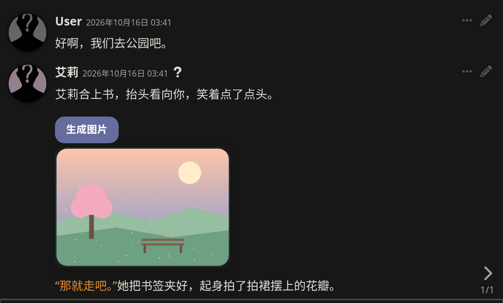
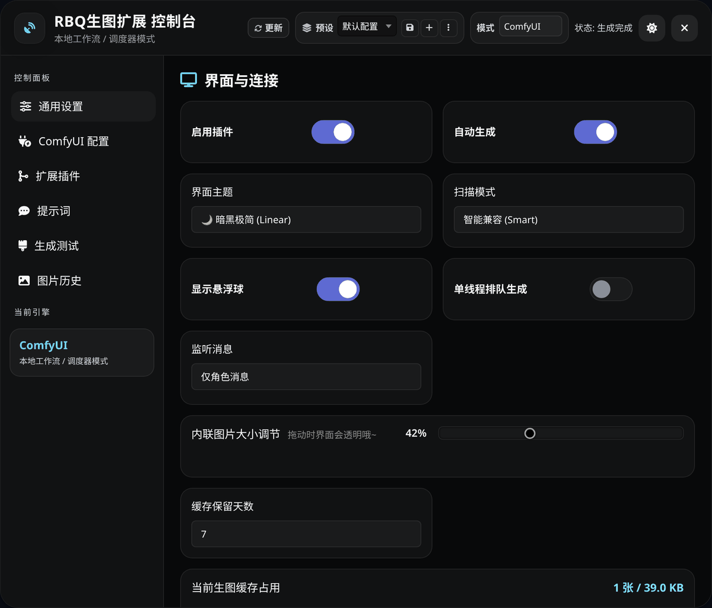

# RBQ生图扩展（SillyTavern-RBQ-Draw）

RBQ生图扩展是一个 [SillyTavern](https://github.com/SillyTavern/SillyTavern)（酒馆）扩展：它识别聊天消息里的生图标签，在消息中原位显示「生成图片」按钮和生成结果。支持 **NovelAI** 和 **ComfyUI**，也可以通过子插件接入其他生图后端，或让 AI 自动为剧情分镜出图。

当前版本：**v0.3.122** · [更新日志](CHANGELOG.md) · [赞助者](SPONSORS.md) · [QQ 交流群：975575164](#交流与反馈)

<p align="center">
  
</p>

---

## 目录

- [功能一览](#功能一览)
- [环境要求](#环境要求)
- [安装与更新](#安装与更新)
- [快速上手](#快速上手)
- [触发规则](#触发规则)
- [后端配置](#后端配置)
- [控制台说明](#控制台说明)
- [子插件](#子插件)
- [常见问题](#常见问题)
- [开发者](#开发者)
- [最近更新](#最近更新)
- [交流与反馈](#交流与反馈)
- [赞助者](#赞助者)
- [许可](#许可)

---

## 功能一览

- **消息内出图**：生图按钮和图片直接显示在聊天消息里，点击图片可全屏查看、缩放、翻页。
- **自动生成**：开启后，AI 回复中的生图标签会自动出图；流式输出时会等回复全部输出完毕再开始。
- **NovelAI**：支持 V4.5 / V5 模型、V5 算力档位，以及 V4.5 的风格迁移（Vibe Transfer）与精准参考（Precise Reference）。
- **ComfyUI**：导入自己的 API 格式工作流（或 ComfyUI 原图 PNG），自动识别节点并填入提示词、尺寸、种子等参数。
- **图片缓存与历史**：生成的图片保存在浏览器本地（IndexedDB），刷新后仍在；可在「图片历史」中搜索、收藏、删除，在查看器中下载原图，也可以在「通用设置」中把全部图片导出为 ZIP。
- **配置预设**：多套连接与参数配置一键切换，支持导入/导出。
- **子插件**：在控制台内浏览和安装子插件，例如由 AI 自动分镜出图的「智能生图触发器」。
- **手机可用**：适配手机浏览器、iOS Safari 和 TauriTavern。

## 环境要求

| 项目 | 说明 |
|------|------|
| SillyTavern | 建议使用最新稳定版（当前版本在 1.19 上测试） |
| NovelAI | NovelAI 账号的 Persistent API Token，或 RBQ 接口的 API Key，或兼容 NAI 协议的自定义接口 |
| ComfyUI | 可访问的 ComfyUI 地址（如 `http://127.0.0.1:8188`）。浏览器直连需要 ComfyUI 允许跨域，启动时加上 `--enable-cors-header`（见[常见问题](#提示无法连接或跨域-cors-错误)） |

## 安装与更新

**安装**

1. 打开 SillyTavern 顶栏的 **扩展程序**（积木图标），点击 **安装扩展程序**。
2. 粘贴仓库地址并确认（管理员账号可选择「只给我安装」或「给所有人安装」）：
   ```text
   https://github.com/TTWParty/SillyTavern-RBQ-Draw
   ```
3. 安装成功后扩展会直接加载，不需要刷新页面或重启 SillyTavern（如果扩展面板里没有出现「RBQ生图扩展」，手动刷新一次页面）。

**更新**

- 有新版本时，控制台顶栏的 **更新** 按钮会变成「发现新版 vX」，扩展面板「RBQ生图扩展」中也会出现更新提示条；点击后查看更新内容并确认更新。
- 更新完成后，按提示 **刷新页面** 才会加载新版本。
- 也可以在 SillyTavern 的 **扩展程序 → 管理扩展程序** 中更新，关闭窗口后页面会自动刷新。
- 当前版本号显示在扩展面板「RBQ生图扩展」底部，点击版本号也可以检查更新。

## 快速上手

1. **打开控制台**，任选一个入口：
   - 屏幕左侧的悬浮球 → **插件设置**；
   - SillyTavern 左下角 ☰ 菜单 → **RBQ生图**；
   - 扩展程序面板 → 展开 **RBQ生图扩展** → **打开 RBQ 生图控制台**。
2. **选择模式**：在控制台顶部的 **模式** 下拉框中选择 ComfyUI 或 NAI（安装了生图类子插件后，这里会出现更多模式）。
3. **填写连接**：在左侧「ComfyUI 配置」/「NAI 配置」页填写地址或密钥，详见[后端配置](#后端配置)。
4. **测试**：打开 **生成测试**，输入一段提示词，点击 **测试生成**，确认能出图。
5. **在聊天中使用**：让 AI 在回复中输出标签，例如：
   ```text
   [img]1girl, silver hair, reading a book, park bench, cherry blossoms[/img]
   ```
   消息里会出现 **生成图片** 按钮，点击即可出图。
6. **自动生成（可选）**：在 **通用设置** 打开 **自动生成**，之后 AI 回复中的标签会自动出图。

> 保存设置：开关、下拉框和单行输入框改动后会自动保存；**负面提示词**、工作流原始 JSON 这类多行文本框不会自动保存，改完后请到「ComfyUI 配置」/「NAI 配置」页底部点击 **保存设置**。

> 提示：可以在角色卡或预设里写明「需要画面时用 `[img]...[/img]` 输出英文标签」，让 AI 按格式输出。也可以安装「智能生图触发器」子插件，由 AI 自动分镜，不需要正文里有标签。

<p align="center">
  
</p>

## 触发规则

**默认识别的标签**（三种同时生效）：

| 格式 | 说明 |
|------|------|
| `[img]提示词[/img]` | 内置 |
| `[scene]提示词[/scene]` | 内置 |
| `image###提示词###` | 由「提示词」页的 **开始标记** / **结束标记** 定义，默认是 `image###` 和 `###`，可以修改；清空其中任意一个即可关闭这种格式 |

- **自定义正则**：在「提示词」页填写，第一个捕获组作为提示词，例如 `\{image:(.*?)\}`。
- **监听消息**（通用设置）：仅角色消息（默认）/ 仅用户消息 / 双方消息。
- **前置提示词 / 后置提示词 / 负面提示词**（「提示词」页）：每次生成时自动加在提示词前后，负面提示词单独发送。

**自动生成的规则**

- 只对最新一条消息自动出图，翻看或重新加载旧消息不会触发；
- 流式输出期间不会生成，等 AI 回复全部输出完毕、正文最终渲染后才开始；开启推理（思维链）自动解析时，只使用最终正文里的标签；
- 中途点击停止生成时，已经完整输出的标签会在停止后生成一次；
- 同一条消息的同一个提示词只自动生成一次，刷新页面或重新渲染只会重新显示已生成的图片；
- 后面的消息即使出现相同的提示词，也会生成属于自己的图片；
- 开启 **单线程排队生成** 后，多张图会按顺序逐张生成。

## 后端配置

### NovelAI

在「NAI 配置」页选择连接方式：

| 连接方式 | 需要填写 |
|----------|----------|
| 🌐 官方 NAI Direct | NovelAI 的 API Token（在 NovelAI 网站的账号设置中获取） |
| ⚡ RBQ 接口 (Relay) | RBQ API Key，填写后点击 **连接并测速** |
| 🔧 自定义接口 (Custom) | 兼容 NAI 协议的接口地址和对应的 Token |

**模型**（下拉框中显示的名称）：`nai-diffusion-5-full`（默认）、`nai-diffusion-5-curated`、`nai-diffusion-4-5-full`、`nai-diffusion-4-5-curated`。

**算力档位 (Effort)**（仅 V5）：

- **High (完整版 / 高算力)**：可自定义步数、采样器、提示词引导缩放和负面提示词；
- **Medium (蒸馏优化 / 14步省点)**：固定 14 步与 Euler Ancestral，提示词引导缩放固定为 0，使用官方固定负面预设（不能自定义负面提示词），约节省 42% 点数。

**参数说明**

- 可调：尺寸（含官方预设）、迭代步数、提示词引导、提示词引导缩放、随机种子、采样器、噪声调度、Variety+（V5 下不可用）。
- 面板中的 SMEA、DYN、Decrisper、Quality Tags 目前不可用，勾选无效。
- 风格迁移和精准参考仅 V4.5 模型可用。

### ComfyUI

1. 在「ComfyUI 配置」页填写 ComfyUI 地址（如 `http://127.0.0.1:8188`），有密钥时一并填写。
2. 点击 **获取模型与参数**，读取可用的模型、采样器和调度器。
3. 不导入工作流时使用内置的基础文生图流程（需要先选择 **Checkpoint 模型**）。需要自定义时，点击 **选择工作流** 旁的导入按钮，导入 ComfyUI 的 **API 格式** 工作流 JSON，或直接导入用该工作流生成的 ComfyUI 原图 PNG；可保存多套并切换。
4. 导入后会自动识别正面/负面提示词、采样器、尺寸、模型和保存图片节点，可以在 **节点参数可视化映射** 中用下拉框改选节点，识别不对时点击 **智能重新识别**。这里也能设置是否允许扩展覆盖采样器/步数/CFG、随机种子、尺寸和模型（模型默认不覆盖，保留工作流里的模型）。多数工作流导入后不需要手动修改。

也可以在工作流里直接写占位符，生成时会自动替换。带引号的占位符（如 `"正面提示词"`、`"CFG"`）要单独作为一个完整的字符串值，例如 `"text": "正面提示词"`、`"cfg": "CFG"`：

| 填入内容 | 占位符 |
|----------|--------|
| 正面提示词 | `{{prompt}}`、`{{positive}}`、`{{positive_prompt}}`、`"正向提示词"`、`"正面提示词"`、`"提示词"` |
| 负面提示词 | `{{negative_prompt}}`、`{{negative}}`、`"反向提示词"`、`"负面提示词"`、`"负向提示词"` |
| 模型 | `{{model}}`、`"模型"`、`"大模型"`、`"基础模型"`、`"UNet模型"`、`"Ultimate模型"`（未选择模型时保留工作流里原有的模型） |
| 宽 / 高 | `{{width}}`、`"宽度"` / `{{height}}`、`"高度"` |
| 步数 | `{{steps}}`、`"步数"` |
| CFG | `{{cfg}}`、`{{scale}}`、`"CFG"`、`"Scale"`、`"引导"` |
| 采样器 / 调度器 | `{{sampler}}`、`"采样器"` / `{{scheduler}}`、`"调度器"` |
| 种子 | `{{seed}}`、`"种子"`（种子为 -1 时每次随机） |
| 文件名前缀 | `{{filename_prefix}}`、`"日期"`；前缀中还可以使用 `%date%`、`%time%` |

### 其他后端

安装生图类子插件（例如「Grok 生图插件」）后，**模式** 下拉框中会出现对应的模式，连接参数由插件提供。

## 控制台说明

控制台顶部可以切换 **预设**（保存、新建、重命名、删除、导入/导出 JSON）和 **模式**；**更新** 按钮用于检查新版本，有新版本时会显示「发现新版 vX」。左侧各页：

| 页面 | 内容 |
|------|------|
| 通用设置 | 启用插件、自动生成、界面主题、扫描模式、显示悬浮球、单线程排队生成、监听消息、内联图片大小调节、缓存保留天数；缓存管理（清理 7 天前旧图片、清空全部缓存、导出全部生图 (ZIP)） |
| ComfyUI 配置 / NAI 配置 | 当前模式的连接与生成参数（名称随模式变化）；页面底部有 **保存设置** |
| 扩展插件 | 子插件的浏览、安装、更新与卸载，可切换仓库源通道 |
| 提示词 | 开始标记、结束标记、前置提示词、后置提示词、负面提示词、自定义正则 |
| 生成测试 | 输入测试提示词并 **测试生成**，用于检查连接和参数 |
| 图片历史 | 已生成的图片，可搜索、只看当前聊天、收藏、删除、复制提示词；点击图片在查看器中打开，可下载原图 |

**扫描模式**：如果标签没有变成生图按钮（常见于魔改前端或特殊美化），依次尝试 智能兼容 (Smart) → 经典模式 (Legacy) → 深度扫描 (Deep)。

## 子插件

在控制台 **扩展插件** 页点击 **刷新**，即可浏览与安装。仓库源通道可选正式版 (main)、测试版 (beta) 或测试版 (jsDelivr CDN加速)，一般使用正式版。

| 插件 | 用途 |
|------|------|
| [智能生图触发器 (Smart Draw Trigger)](https://github.com/TTWParty/RBQ-Draw-Plugins/blob/main/docs/plugins/rbq-smart-draw-trigger.md) | 调用 LLM 理解剧情并自动分镜出图，正文里不需要写标签；支持多角色构图 |
| [角色工坊 (Character Workshop)](https://github.com/TTWParty/RBQ-Draw-Plugins/blob/main/docs/plugins/rbq-character-workshop.md) | 管理角色外貌档案与服装，保持角色形象一致 |
| [漫画模式 (Manga Mode)](https://github.com/TTWParty/RBQ-Draw-Plugins/blob/main/docs/plugins/rbq-manga-mode.md) | 将剧情自动分镜成漫画页（配合智能生图触发器与 NAI V5） |
| [NAI 多角色模式 (Multi-Char)](https://github.com/TTWParty/RBQ-Draw-Plugins/blob/main/docs/plugins/rbq-multi-char.md) | 支持多角色提示词格式与坐标，对应 NAI V4.5 / V5 的多角色功能 |
| [提示词预设 (Prompt Presets)](https://github.com/TTWParty/RBQ-Draw-Plugins/blob/main/docs/plugins/rbq-prompt-presets.md) | 保存常用的正面/负面提示词组合，生成时自动拼接 |
| [提示词预设工坊 (Prompt Market)](https://github.com/TTWParty/RBQ-Draw-Plugins/blob/main/docs/plugins/rbq-prompt-market.md) | 浏览和分享社区画师串与提示词预设 |
| [NAI 图片信息提取器](https://github.com/TTWParty/RBQ-Draw-Plugins/blob/main/docs/plugins/rbq-png-metadata.md) | 读取 NovelAI / SD / ComfyUI 图片中保存的提示词与参数 |
| [图库云同步与存储管理 (Gallery Sync & Storage)](https://github.com/TTWParty/RBQ-Draw-Plugins/blob/main/docs/plugins/rbq-gallery-sync.md) | 把图片同步到酒馆服务端，换设备也能看到 |
| [图片隐私模式 (Image Privacy Mode)](https://github.com/TTWParty/RBQ-Draw-Plugins/blob/main/docs/plugins/rbq-image-privacy-mode.md) | 折叠或遮挡正文中的图片，适合公共场合 |
| [Grok 生图插件 (Grok Draw)](https://github.com/TTWParty/RBQ-Draw-Plugins/blob/main/docs/plugins/rbq-grok-draw.md) | 新增 Grok 生图模式 |
| [摸鱼悬浮球](https://github.com/TTWParty/RBQ-Draw-Plugins/blob/main/docs/plugins/rbq-custom-floating-icon.md) | 更换悬浮球样式 |
| [(xh)Fish语音 (Fish Audio TTS)](https://github.com/TTWParty/RBQ-Draw-Plugins/blob/main/docs/plugins/rbq-fish-tts.md) | 用 Fish Audio 为剧情配音 |
| [安卓保存修复 (Save Downloads Fix)](https://github.com/TTWParty/RBQ-Draw-Plugins/blob/main/docs/plugins/rbq-save-downloads-fix.md) | 修复安卓版 TauriTavern 保存图片时报错 |

> 智能生图触发器需要单独配置一个 LLM 接口。v6.5.46 起，如果浏览器直连该接口被跨域拦截，它会自动改走 SillyTavern 自带的代理，再不行则通过 SillyTavern 后端转发；只有这些方式都失败时，才会提示你在 SillyTavern 的 `config.yaml` 中设置 `enableCorsProxy: true` 并重启 SillyTavern。如果接口不是 OpenAI 兼容格式（自定义 HTTP 请求），无法通过后端转发，仍需开启 `enableCorsProxy` 并重启。

## 常见问题

### 标签没有变成「生成图片」按钮

确认 **启用插件** 已打开、**监听消息** 包含这条消息的发送方、标签格式正确；仍不行时在 **扫描模式** 中切换 经典模式 (Legacy) 或 深度扫描 (Deep)。

### 提示「无法连接」或跨域 (CORS) 错误

- ComfyUI：启动时加上 `--enable-cors-header`，并确认地址能在浏览器中打开；
- NAI 自定义接口：确认地址正确、服务端允许跨域；
- 智能生图触发器的 LLM 接口：更新到 v6.5.46 及以上；非 OpenAI 兼容格式的接口需要在 `config.yaml` 中设置 `enableCorsProxy: true` 并重启 SillyTavern。

### 同一张图生成了两次，或流式输出中途就开始生图

v0.3.122 之前版本的问题，更新到最新版本即可。

### 刷新页面或换设备后图片不见了

图片只缓存在当前浏览器，超过 **缓存保留天数** 或清空缓存后会被删除。需要跨设备查看时，安装「图库云同步与存储管理」子插件。

### 安卓 TauriTavern 保存图片报错

安装「安卓保存修复 (Save Downloads Fix)」子插件。

## 开发者

扩展通过 `window.RBQ` 向子插件开放接口，常用的有：

- `RBQ.api.registerMode(id, meta, generateFn)`：注册新的生图模式，会出现在 **模式** 下拉框中；
- `RBQ.api.generateImage(prompt, reason, meta, onProgress)`：调用当前模式生成图片；
- `RBQ.api.getSettings()`、`RBQ.api.isStreamingActive()`、`RBQ.api.getContext()` 等读取状态的方法；
- `RBQ.on(event, callback)`：在生成请求发出前修改请求内容，例如 `buildNaiV4Payload`（NAI 请求参数）、`buildComfyUiWorkflow`（ComfyUI 工作流）；
- `RBQ.ui.addSettingPanel(id, title, renderHtmlFn)`：在控制台中添加设置页。

入门示例见 [Hello World 子插件说明](https://github.com/TTWParty/RBQ-Draw-Plugins/blob/main/docs/plugins/rbq-core-hello.md)，全部子插件源码在 [RBQ-Draw-Plugins](https://github.com/TTWParty/RBQ-Draw-Plugins)。

## 最近更新

- **v0.3.122**：自动生成改为等 AI 回复全部输出完毕后再开始，修复流式输出时同一张图生成两次的问题；已生成的图片刷新后直接显示不再重复生成；后面的消息出现相同提示词时也能正常出图。
- **v0.3.118 – v0.3.121**：NAI 自定义接口兼容性优化。
- **v0.3.117**：修复 v0.3.116 引入的生图报错。
- **v0.3.116**：提示词工坊试炼与基准测试不再叠加本地前后置提示词、画师预设和参考图。
- **v0.3.115**：自动修正 NovelAI 权重语法中结尾紧贴数字的情况，避免画面崩坏。

完整记录见 [CHANGELOG.md](CHANGELOG.md)。

## 交流与反馈

- QQ 交流群：Novel ai 绘图交流群，群号 **975575164**（在 QQ 中搜索群号加入）。
- 遇到 Bug 请优先到 [GitHub Issues](https://github.com/TTWParty/SillyTavern-RBQ-Draw/issues) 提交，并附上：SillyTavern 版本、扩展版本、所用模式（NAI / ComfyUI / 子插件）、复现步骤，以及浏览器控制台中的报错信息（提交前删掉其中的密钥）。

## 赞助者

感谢以下朋友的支持（[完整名单与赞助方式](SPONSORS.md)）：

<a href="SPONSORS.md"></a>
<a href="SPONSORS.md"></a>

## 许可

<!-- TODO(许可证)：项目目前没有声明开源许可证，请作者确定后在这里注明（例如 MIT / GPL-3.0 / 保留所有权利），并在仓库根目录添加 LICENSE 文件。 -->

暂未声明许可证。

---

Made with ❤️ by TTWParty
